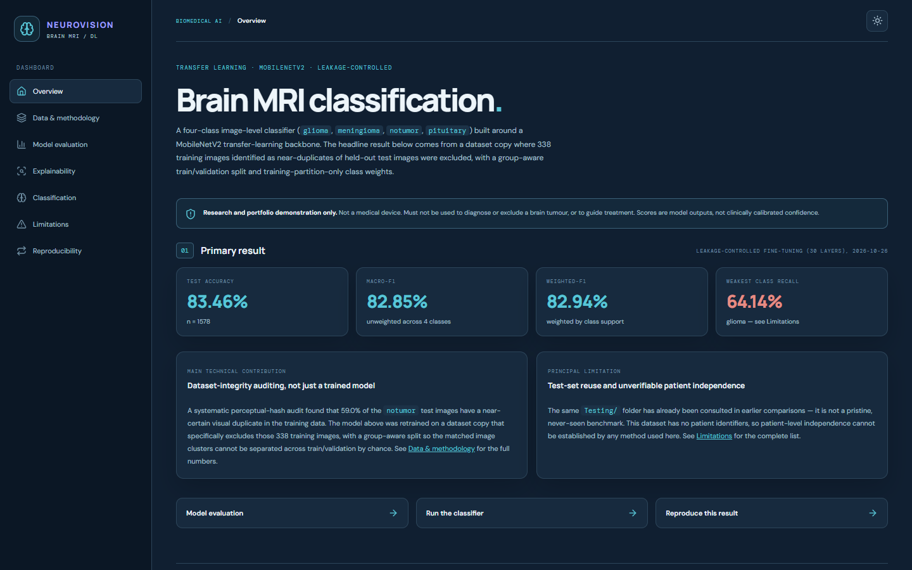
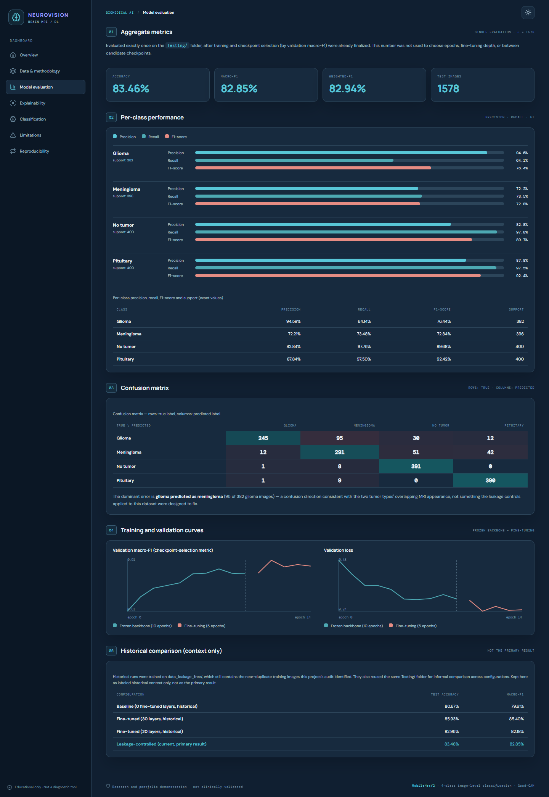
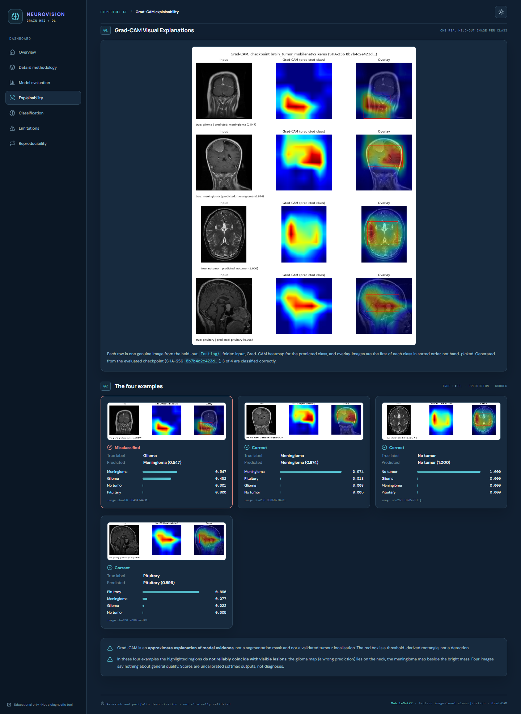
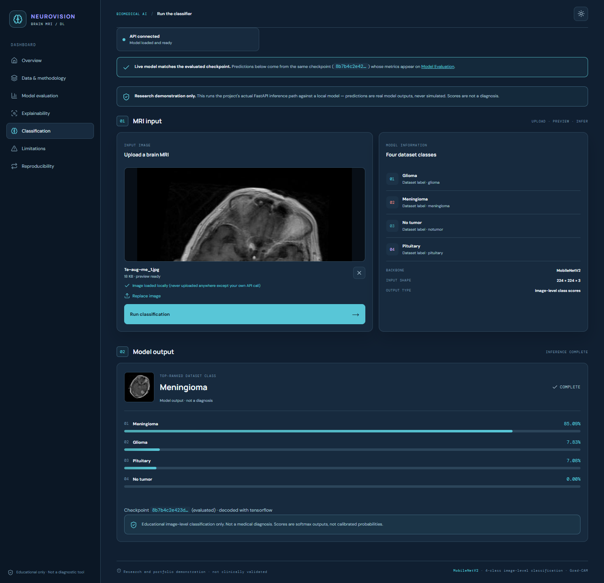
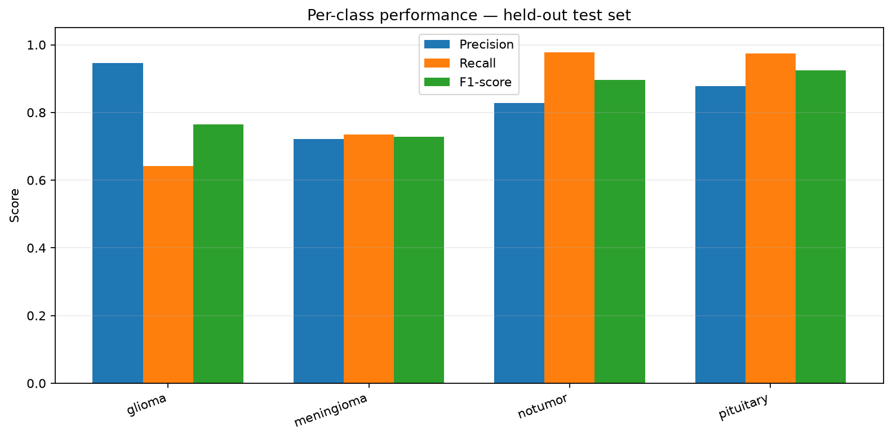
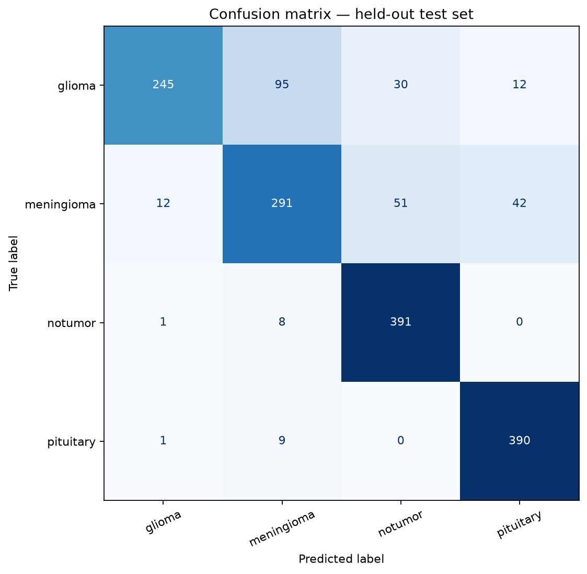
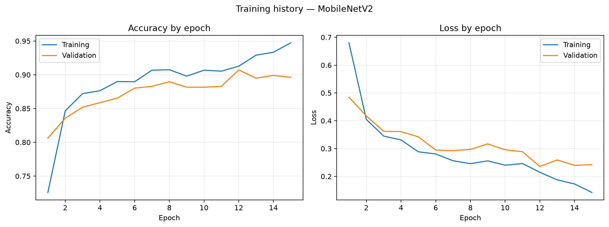
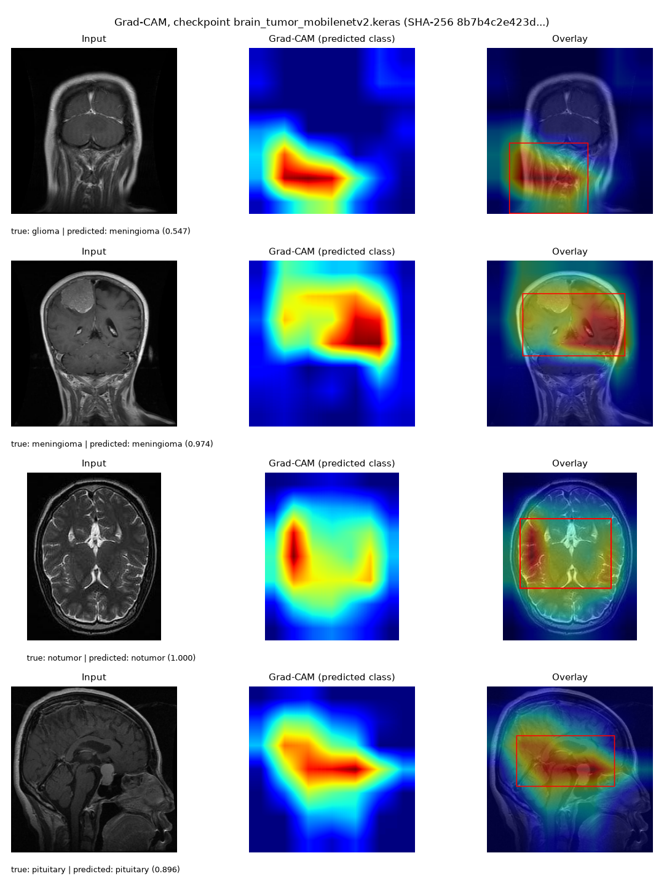

# Brain Tumor MRI Classification with Explainable Deep Learning

A four-class brain MRI classifier (**glioma · meningioma · no tumor · pituitary**) built on MobileNetV2 transfer learning, with genuine **Grad-CAM** explanations, a leakage-controlled evaluation, a FastAPI inference service and a React dashboard.

> **Educational / research portfolio project. Not a medical device and not clinically validated.** Predictions must never be used to diagnose or exclude a brain tumour or to guide treatment. See [Limitations](#limitations-and-ethical-considerations).



## Verified results at a glance

| Metric (held-out `Testing/` folder) | Result |
|---|---:|
| Test accuracy | **83.46 %** |
| Macro F1-score | **82.85 %** |
| Weighted F1-score | 82.94 % |
| Test images | 1,578 |

These values were checked against the saved experiment record (`frontend/src/data/results.json`, derived from the experiment record of checkpoint SHA-256 `8b7b4c2e…d6f63f`) and match the previously reported 83.46 % / 82.85 % / 1,578. They come from **one training run with one seed**, on an image-level (not patient-level) split; see the limitations below before reading anything into them.

## Problem and objectives

Brain MRI slices are routinely sorted into tumour types; an automated classifier is a common teaching problem in biomedical image analysis. This project asks a deliberately modest question: *how well does a compact, fine-tuned MobileNetV2 separate four dataset labels, once obvious data leakage is controlled, and what does it look at when it decides?*

Objectives:

1. Train and evaluate a four-class image-level classifier.
2. Audit the dataset for duplicate/near-duplicate leakage and retrain on a leakage-controlled copy.
3. Explain predictions with Grad-CAM, and be explicit about what such maps do and do not show.
4. Serve the model through a validated API and present results in a dashboard that reads only genuine result files.

## Main features

- MobileNetV2 (ImageNet weights) with a frozen-backbone phase followed by fine-tuning of the last 30 layers.
- Perceptual-hash near-duplicate audit; 338 training images that matched test images were excluded, and a group-aware train/validation split was used.
- Class weights computed from the training partition only; checkpoint chosen by validation macro-F1.
- Grad-CAM figure generated from the evaluated checkpoint, with image hashes and scores recorded per example.
- FastAPI service with strict upload validation, model-identity reporting (SHA-256) and non-leaky error messages.
- React/Vite dashboard: overview, methodology, evaluation, explainability, live classification, limitations, reproducibility.

## Dashboard

| Evaluation | Explainability |
|---|---|
|  |  |



*The screenshots above are captured from the running application (FastAPI + Vite) with the evaluated checkpoint loaded. The image in the prediction screenshot is a public-dataset test image used purely to demonstrate the interface; one image says nothing about accuracy.*

Further pages: [Data & methodology](docs/images/methodology.png) · [Limitations](docs/images/limitations.png)

## Results

### Per-class performance

| Class | Precision | Recall | F1 | Support |
|---|---:|---:|---:|---:|
| Glioma | 94.59 % | 64.14 % | 76.44 % | 382 |
| Meningioma | 72.21 % | 73.48 % | 72.84 % | 396 |
| No tumor | 82.84 % | 97.75 % | 89.68 % | 400 |
| Pituitary | 87.84 % | 97.50 % | 92.42 % | 400 |



Glioma recall (64 %) is the weakest figure: the model is precise when it says "glioma" but misses many gliomas.

### Confusion matrix (rows = true label, columns = predicted)

| | Glioma | Meningioma | No tumor | Pituitary |
|---|---:|---:|---:|---:|
| **Glioma** | 245 | 95 | 30 | 12 |
| **Meningioma** | 12 | 291 | 51 | 42 |
| **No tumor** | 1 | 8 | 391 | 0 |
| **Pituitary** | 1 | 9 | 0 | 390 |



The dominant error is glioma predicted as meningioma (95 of 382).

### Training curves



Ten frozen-backbone epochs followed by five fine-tuning epochs; the checkpoint was selected on validation macro-F1.

### Historical context (not the primary result)

Earlier runs on a dataset copy that still contained the near-duplicate training images scored higher on the same `Testing/` folder (for example 85.93 % accuracy for a 30-layer fine-tune). The leakage-controlled result above is lower, which is the expected direction when duplicated images are removed; the earlier numbers are kept only as context, and the `Testing/` folder was consulted across those comparisons, so it is not a pristine benchmark.

## Grad-CAM explainability



Each row is the first test image of its class in sorted order (not hand-picked): **input MRI · Grad-CAM heatmap for the predicted class · overlay** (the red box is a threshold-derived rectangle, not a detection). Provenance (image hashes, checkpoint hash) is in [`frontend/src/data/gradcam_examples.json`](frontend/src/data/gradcam_examples.json).

| Class (ground truth) | Predicted | Score of predicted class | Outcome |
|---|---|---:|---|
| Glioma | Meningioma | 0.547 (glioma: 0.452) | **Misclassified** |
| Meningioma | Meningioma | 0.974 | Correct |
| No tumor | No tumor | 1.000 | Correct |
| Pituitary | Pituitary | 0.896 | Correct |

**Reading these honestly.** Grad-CAM is an approximate attribution method. It is not a segmentation or a validated tumour localisation. In these examples the highlighted regions do **not** reliably coincide with visible lesions; for the misclassified glioma the map falls on the lower part of the head/neck region, and for the meningioma it sits beside the bright mass rather than on it. Four images say nothing about general behaviour, and scores are uncalibrated softmax outputs.

## Model and workflow

```
MRI image (PNG/JPG/BMP/WEBP)
  → decode + bilinear resize to 224×224×3, raw 0–255 pixels
  → [in-model] MobileNetV2 preprocessing (scaling to [-1, 1])
  → MobileNetV2 backbone (ImageNet weights; last 30 layers fine-tuned)
  → global average pooling + dropout 0.25 + dense softmax over 4 classes
     (random flip / small rotation / zoom augmentation during training only)
  → scores for glioma / meningioma / notumor / pituitary
```

Training configuration of the evaluated run (from the experiment record): seed 42, validation split 0.15 (group-aware), image size 224, 10 frozen epochs + 5 fine-tuning epochs, class weights from the training partition, selection metric `val_macro_f1`.

## Dataset and split methodology

The data are the public [Brain Tumor MRI Dataset on Kaggle](https://www.kaggle.com/datasets/masoudnickparvar/brain-tumor-mri-dataset) (check its current terms before use). **No data are included in this repository.**

| Class | Training (original) | Training (after leakage exclusion) | Testing (unchanged) |
|---|---:|---:|---:|
| Glioma | 1,396 | 1,396 | 382 |
| Meningioma | 1,288 | 1,282 | 396 |
| No tumor | 1,257 | 927 | 400 |
| Pituitary | 1,355 | 1,353 | 400 |

- A perceptual-hash audit (Hamming distance 0) found 236 connected duplicate clusters; 187 touch a test image. All **338** training members of those clusters (330 no-tumor, 6 meningioma, 2 pituitary) were excluded from training; `Testing/` was never modified. The remaining 49 training-only clusters were kept together on one side of the train/validation split.
- The split is **not patient-level**: the dataset carries no patient identifiers.
- Exact-duplicate and near-duplicate auditing was performed, but **residual near-duplicates (for example other slices of the same patient) may remain**.

## Model weights

The evaluated checkpoint **is included** (21.8 MB, below GitHub's file-size limit, regular Git, no LFS):

```
artifacts_finetune30_leakagecontrolled_20261026/brain_tumor_mobilenetv2.keras
SHA-256 8b7b4c2e423d18d72d72bb25773b906b03c2a9a6a8cf40b060de1e56a0d6f63f
```

Verify it with `Get-FileHash <file> -Algorithm SHA256` (PowerShell). The API reports the hash of the model it serves at `/api/status` and the dashboard compares it with the evaluated hash. Set `BRAIN_TUMOR_MODEL_PATH` to serve a different checkpoint; the dashboard then states that it is *not* the evaluated one. The weights load with TensorFlow 2.19.1 / Keras 3.15.1 (other Keras versions may fail to deserialize `.keras` files; the API then reports `load_failed` instead of guessing).

## Installation (Windows)

Prerequisites: Python 3.11, Node.js 20+, Git.

```powershell
git clone https://github.com/ghada-59/Brain-Tumor-MRI-Deep-Learning.git
cd Brain-Tumor-MRI-Deep-Learning

python -m venv .venv
.\.venv\Scripts\Activate.ps1
python -m pip install -r requirements-react-api.txt tensorflow==2.19.1 pillow numpy
```

(A conda environment with Python 3.11, TensorFlow 2.19.1 and Keras 3.15.1 works equally well.)

### Start the API

```powershell
python -m uvicorn api:app --host 127.0.0.1 --port 8000
```

### Start the dashboard

```powershell
cd frontend
npm install
npm run dev        # http://127.0.0.1:5173
```

The Evaluation, Explainability and Methodology pages work from saved result files even without the API; only the Classification page needs it. Set `VITE_API_BASE` if the API runs elsewhere.

## API

| Method | Path | Purpose |
|---|---|---|
| GET | `/api/health` | Liveness only |
| GET | `/api/status` | Model state (`missing`, `not_loaded`, `ready`, `load_failed`), SHA-256, input shape, classes, TensorFlow/Keras versions |
| POST | `/api/predict` | Classify one uploaded image (multipart field `file`) |

```powershell
curl.exe -F "file=@C:\path\to\mri.jpg" http://127.0.0.1:8000/api/predict
```

```json
{
  "filename": "mri.jpg",
  "top_class": "meningioma",
  "classes": [{"label": "meningioma", "score": 0.85}, "..."],
  "scores": {"glioma": 0.08, "meningioma": 0.85, "notumor": 0.0, "pituitary": 0.07},
  "preprocessing": {"decoder": "tensorflow", "image_size": 224},
  "model": {"sha256": "8b7b4c2e…", "variant": "evaluated"},
  "note": "Educational image-level classification only…"
}
```

Errors are JSON `{"detail": "..."}`: 400 undecodable/empty/missing `file`, 413 file > 15 MB or too many pixels, 415 unsupported type, 503 model missing or failed to load (no server paths are leaked), 500 invalid model output.

## Tests

```powershell
python -m pytest -q tests          # backend
cd frontend; npm test; npm run build
```

## Repository structure

```
api.py                         FastAPI service
src/brain_tumor_dl/            model, data, inference, serving, Grad-CAM, leakage audit helpers
train.py, predict.py, app.py   baseline training / CLI inference / legacy Streamlit demo
prepare_leakage_controlled_dataset.py   builds the leakage-controlled dataset copy
make_gradcam_figure.py         generates the Grad-CAM figure from the evaluated checkpoint
frontend/                      React + Vite dashboard (src/data holds the genuine result files)
frontend/public/results/       figures used by the dashboard and this README
docs/images/                   dashboard screenshots
artifacts_finetune30_leakagecontrolled_20261026/   evaluated checkpoint + class list
tests/                         pytest suite
```

`src/brain_tumor_dl/tpal*.py` and `train_tpal.py` are a separate, experimental PyTorch Transformer-style classifier that was **never trained end to end**; it has no results and is not part of the reported numbers. `app.py` is an older Streamlit demo that loads the legacy `artifacts/` model path, not the evaluated checkpoint.

## Reproducibility

The configuration of the evaluated run is recorded in the experiment record and shown on the dashboard's *Reproducibility* page (seed, split, class weights, library versions, git commit `f0cc2d9`). **Be aware of the scope:** the `train.py` in this repository implements the plain frozen/fine-tuning workflow; the exact script variant that used a group manifest, class weights and macro-F1 checkpoint selection is not included, so the run is documented and its checkpoint verifiable, but not reproducible with one command. The dataset-preparation and Grad-CAM scripts are included.

## Limitations and ethical considerations

- **Not for clinical use.** Not a medical device, not validated against radiologist ground truth, not tested prospectively or across scanners/sites.
- **The split is not patient-level.** Slices of the same patient can appear on both sides, so the metrics are probably optimistic and do not demonstrate clinical generalisation.
- **Near-duplicates may remain.** Only exact/near-identical images at the strictest hash threshold were audited and removed.
- **Test-set reuse.** The same `Testing/` folder was used in earlier configuration comparisons.
- **Softmax scores are not calibrated probabilities.**
- **Grad-CAM is an approximate explanation**, not a tumour segmentation or localisation; it can highlight anatomy or artefacts. This project does **not** perform tumour segmentation.
- **Single run, single seed:** no variance estimate or confidence intervals exist, and none are claimed.
- **Class-level weakness:** glioma recall is 64 %; the glioma example in the Grad-CAM figure is misclassified and is shown on purpose.

## Technologies

Python 3.11 · TensorFlow/Keras · NumPy · Pillow · scikit-learn · FastAPI · Uvicorn · React 18 · Vite · React Router · Lucide icons · pytest · Node test runner · GitHub Actions.

## Acknowledgements and references

- Dataset: [Brain Tumor MRI Dataset](https://www.kaggle.com/datasets/masoudnickparvar/brain-tumor-mri-dataset) on Kaggle (please cite the dataset and its original sources separately).
- Sandler et al., *MobileNetV2: Inverted Residuals and Linear Bottlenecks*, CVPR 2018.
- Selvaraju et al., *Grad-CAM: Visual Explanations from Deep Networks via Gradient-based Localization*, ICCV 2017.

Released under the [MIT License](LICENSE); see [CITATION.cff](CITATION.cff).
