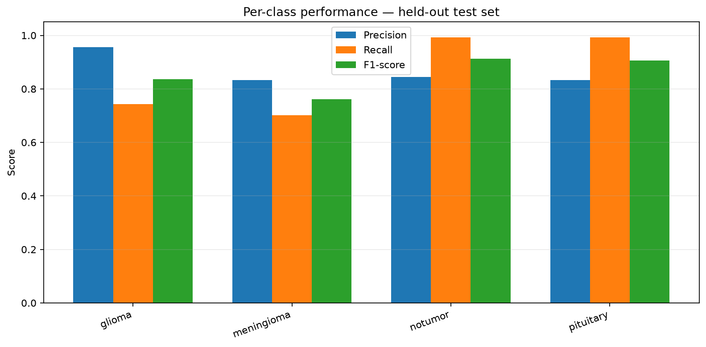
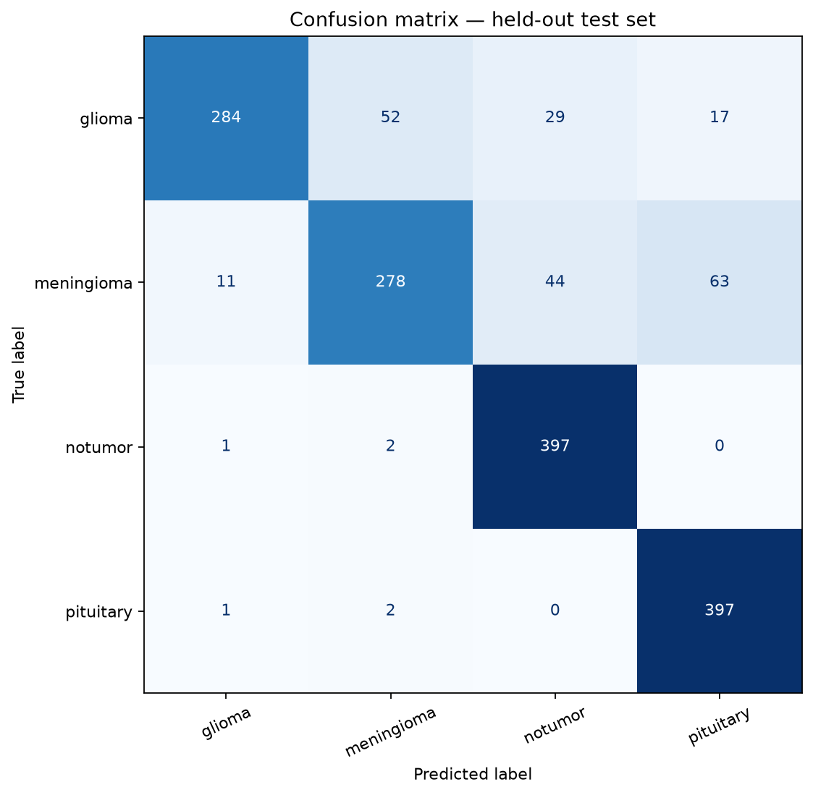
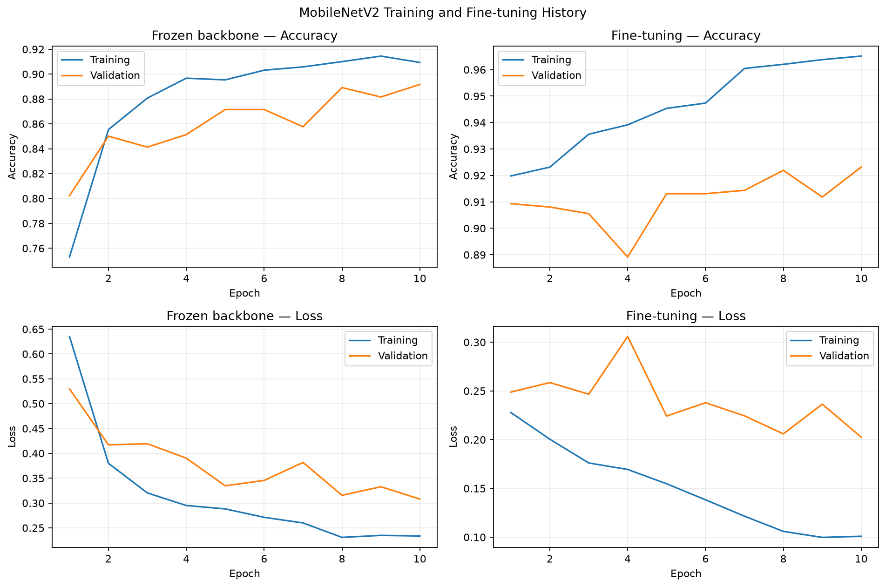

# Brain Tumor MRI Classification — Deep Learning

An educational biomedical-imaging project for four-class brain MRI classification. It keeps a TensorFlow/Keras MobileNetV2 baseline and adds a separate PyTorch implementation inspired by **T-PAL (Trainable Transformer-Based Pixel Association Learning)** from the supplied research notebook.

This repository is for learning and portfolio demonstration. It is not a medical device and must not be used to diagnose or exclude a brain tumour or guide treatment. Neither classifier nor its visual explanations is clinically validated.

## Research question

Can a compact pixel-association Transformer provide a useful comparison with a MobileNetV2 transfer-learning classifier for image-level classification into these dataset labels?

- `glioma`
- `meningioma`
- `notumor` (no tumor)
- `pituitary`

Classification predicts a label for the whole image. It does not by itself segment a tumour or establish its location.

## Model approaches

### MobileNetV2 (TensorFlow/Keras)

The existing transfer-learning pipeline includes class-stratified train/validation splitting, a held-out `Testing/` folder, optional fine-tuning, aggregate evaluation reports, CLI inference, a Streamlit demonstration, and Grad-CAM visualization.

### T-PAL-style pixel-association Transformer (PyTorch)

The experimental path is separate from MobileNetV2:

- A compact convolutional stem maps a grayscale MRI to a spatial token grid.
- Learnable multi-head attention estimates relationships between tokens.
- A Gaussian spatial prior is combined with learned attention.
- A gated residual update and feed-forward block refine token features.
- The pooled representation is classified into the four dataset classes.
- Optional association and attention-diversity penalties are available during training.

The implementation is inspired by the supplied T-PAL notebook and is not claimed to be an exact reproduction of the paper's experimental protocol. It preserves the existing TensorFlow model and its artifact format.

## Visual explanations

The Streamlit application provides a Grad-CAM view for MobileNetV2. The T-PAL command-line tool can export a side-by-side image containing:

1. The original MRI.
2. A blue visualization combining input-gradient saliency and attention rollout.
3. An overlay with a red box around a thresholded high-activation region.

The red box is a rough visualization derived from model activation. It is not a trained object detector, a ground-truth box, or a validated tumour boundary. Attention and saliency can highlight anatomy, artifacts, image borders, or other learned patterns; they do not prove where a tumour is located.

## Repository layout

- `train.py`, `predict.py` — MobileNetV2 training and single-image inference.
- `app.py`, `api.py` — local Streamlit interface and optional FastAPI service.
- `src/brain_tumor_dl/model.py` — MobileNetV2 model.
- `src/brain_tumor_dl/data.py` — MobileNetV2 dataset loading and stratified split.
- `src/brain_tumor_dl/evaluation.py` — MobileNetV2 metrics and plots.
- `src/brain_tumor_dl/explainability.py` — Grad-CAM visualization.
- `src/brain_tumor_dl/tpal.py` — T-PAL-style PyTorch architecture and regularization.
- `src/brain_tumor_dl/tpal_data.py` — grayscale dataset loading and training-only normalization statistics.
- `src/brain_tumor_dl/tpal_explainability.py` — T-PAL saliency/attention maps and approximate activation boxes.
- `train_tpal.py` — T-PAL training and held-out evaluation.
- `explain_tpal.py` — export a T-PAL explanation for one image.
- `compare_model_reports.py` — combine recorded metrics into a comparison CSV.
- `prepare_clean_dataset.py`, `audit_dataset.py` — dataset preparation and exact-duplicate audits.
- `tests/` — automated tests; T-PAL unit tests run when PyTorch is installed.
- `.github/workflows/tests.yml` — GitHub Actions test workflow.

Datasets and trained model weights are intentionally not committed. Generated checkpoints and reports are written to local output folders.

## Dataset setup

Download the [Brain Tumor MRI Dataset on Kaggle](https://www.kaggle.com/datasets/masoudnickparvar/brain-tumor-mri-dataset) yourself and check its current terms before use. Arrange the folders with matching class names:

```text
data/
├── Training/
│   ├── glioma/
│   ├── meningioma/
│   ├── notumor/
│   └── pituitary/
└── Testing/
    ├── glioma/
    ├── meningioma/
    ├── notumor/
    └── pituitary/
```

Check the folder structure:

```powershell
python check_dataset.py
```

Create the deduplicated copy used by the recorded MobileNetV2 experiment:

```powershell
python prepare_clean_dataset.py
python check_dataset.py --data-dir data_leakage_free
python audit_dataset.py --data-dir data_leakage_free --validation-split 0.15 --seed 42
```

The preparation script creates `data_leakage_free/` and does not modify the original `data/` folder. It refuses to overwrite an existing output folder. Inspect an existing output folder rather than deleting it blindly.

Exact-duplicate checks do not detect all near-duplicates and do not prove patient-level independence. Patient identifiers are unavailable, so patient-level separation cannot be verified.

## Environment setup

Use Python 3.11 from Anaconda Prompt or a terminal opened at the repository root.

```powershell
conda create --prefix D:\anaconda_envs\brain-tumor-dl python=3.11 -y
conda activate D:\anaconda_envs\brain-tumor-dl
python -m pip install --upgrade pip
python -m pip install -r requirements.txt
```

The T-PAL experiment is an optional PyTorch component. Install its separate dependency file when you are ready to run it:

```powershell
python -m pip install -r requirements-tpal.txt
```

## Run automated tests

```powershell
python -m pytest -q
```

Run tests locally before treating any code change as validated. GitHub Actions provides a separate CI check; a successful CI run does not replace testing the full training workflow with your local dataset and hardware.

## MobileNetV2 experiment

### Baseline

```powershell
python train.py --data-dir data_leakage_free --output-dir artifacts_clean --reports-dir reports_clean --epochs 10 --batch-size 32 --image-size 224 --validation-split 0.15 --weights imagenet --seed 42
```

### Fine-tuning

```powershell
python train.py --data-dir data_leakage_free --output-dir artifacts_finetune --reports-dir reports_finetune --epochs 10 --batch-size 32 --image-size 224 --validation-split 0.15 --weights imagenet --seed 42 --fine-tune-layers 30
```

The recorded MobileNetV2 experiments reported the following aggregate results on a held-out test folder containing 1,578 images. Re-run the pipeline to reproduce the experiment in your own environment.

| Metric | Baseline | Fine-tuned |
|---|---:|---:|
| Test accuracy | 80.67% | 85.93% |
| Macro-F1 | 79.61% | 85.40% |
| Weighted-F1 | 79.66% | 85.45% |

### Recorded fine-tuned model outputs

These figures are the saved plots from the recorded MobileNetV2 fine-tuning run. They show class-level performance, test-set errors, and the training/validation curves; they are not evidence of tumour localization.

**Per-class metrics**



**Held-out test confusion matrix**



**Training and validation curves**



The recorded fine-tuned recall for meningioma was 70.20%, illustrating that overall accuracy does not describe all class-specific failure modes. Potential patient-level leakage cannot be ruled out, and these results may be optimistic. Performance on this dataset does not establish generalization to other hospitals, scanners, protocols, or populations.

## T-PAL experiment

Train a T-PAL model using the same cleaned dataset folder structure:

```powershell
python train_tpal.py --data-dir data_leakage_free --output-dir artifacts_tpal --reports-dir reports_tpal --epochs 30 --batch-size 32 --image-size 128 --validation-split 0.15 --seed 42
```

For limited memory, try `--batch-size 16`. The script selects a checkpoint using validation macro-F1, applies early stopping, and computes the final metrics once on the separate `Testing/` folder. It saves:

- `artifacts_tpal/tpal_best.pt` — selected model checkpoint and preprocessing metadata.
- `reports_tpal/test_metrics.json` — aggregate held-out metrics.
- `reports_tpal/classification_report.json` and `per_class_metrics.csv` — class-level results.
- `reports_tpal/confusion_matrix.png` — held-out confusion matrix.
- `reports_tpal/training_history.csv` and `training_curves.png` — training/validation history.

Export an explanation for one image after training:

```powershell
python explain_tpal.py "D:\path\to\an\MRI-image.jpg" --checkpoint artifacts_tpal/tpal_best.pt --output reports_tpal/explanations/example.png
```

The exported image includes the original input, blue saliency/attention visualization, and an approximate red activation box. These are model-explanation views, not validated tumour localization.

## Compare recorded metrics

```powershell
python compare_model_reports.py --baseline artifacts_clean/test_metrics.json --finetuned artifacts_finetune/test_metrics.json --tpal reports_tpal/test_metrics.json --output reports_model_comparison/model_comparison.csv
```

The comparison utility combines existing metric files; it does not train models or prove that their test images are identical. A fair comparison requires the exact same held-out image list, labels, and preprocessing for all models. Matching test-set counts alone is insufficient. Confirm the evaluation protocol before making a performance claim.

## Local inference interfaces

After training MobileNetV2, run a single-image prediction:

```powershell
python predict.py "D:\path\to\an\MRI-image.jpg" --model artifacts_clean/brain_tumor_mobilenetv2.keras --classes artifacts_clean/class_names.json
```

The Streamlit app and FastAPI service look in `artifacts/`. To use a selected checkpoint, copy the model and its matching class list into that directory. For example, to copy the fine-tuned checkpoint:

```powershell
New-Item -ItemType Directory -Force artifacts | Out-Null
Copy-Item artifacts_finetune/brain_tumor_mobilenetv2.keras artifacts/brain_tumor_mobilenetv2.keras
Copy-Item artifacts_finetune/class_names.json artifacts/class_names.json
```

For the baseline, replace `artifacts_finetune/` in the two copy commands with `artifacts_clean/`.

The shared path resolver prefers `artifacts/brain_tumor_mobilenetv2_repaired.keras` when that locally repaired file exists. Otherwise, it uses `artifacts/brain_tumor_mobilenetv2.keras` when available. If you want to use the copied canonical model, check whether the repaired artifact is present, because it takes priority. Trained weights are not included in GitHub.

Launch Streamlit:

```powershell
python -m streamlit run app.py
```

Launch the optional FastAPI service:

```powershell
python -m uvicorn api:app --host 127.0.0.1 --port 8000
```

Open `http://127.0.0.1:8000/docs` to explore the API. The API and Streamlit interface require a model file and matching `class_names.json` in `artifacts/`.

## Responsible interpretation

- Model scores are not calibrated clinical confidence.
- Classification is not segmentation or object detection.
- Saliency/attention maps are explanatory views and may not align with a true tumour boundary.
- Red boxes are threshold-derived visualization aids, not ground-truth localization.
- Do not report the supplied PDF's T-PAL score as a result of this implementation. Only report measurements obtained from a reproducible local run, with its dataset split and configuration.
- This project is for education and portfolio demonstration, not clinical use.
