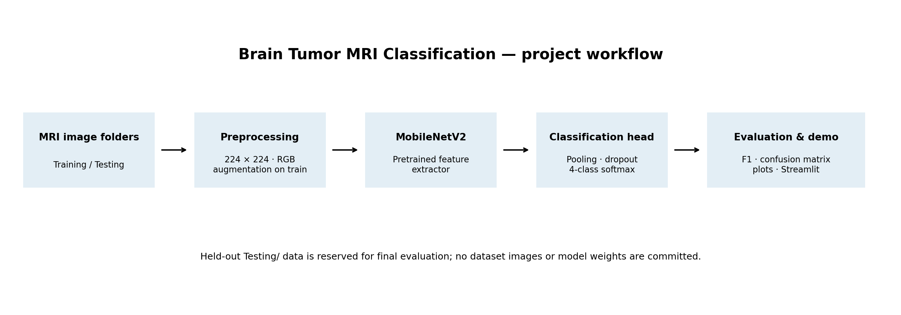

# Brain Tumor MRI Classification — Deep Learning Practice Project

An educational biomedical-imaging portfolio project for four-class brain MRI image classification using TensorFlow/Keras and MobileNetV2 transfer learning. The repository includes dataset preparation and duplicate audits, a stratified training/validation split, baseline and fine-tuning experiments, aggregate evaluation reports, command-line inference, tests, and a Streamlit demonstration.

> **Safety and scope:** this is a learning project, not a medical device. It must not be used to diagnose or exclude a brain tumour or guide treatment. The model is not clinically validated, and its scores are not calibrated clinical confidence.

## Task and classes

The dataset classes are `glioma`, `meningioma`, `notumor` (no tumor), and `pituitary`. This is image-level classification only; it does not segment, outline, or localize a tumour and does not process DICOM series or 3D volumes.

## Pipeline



1. Read image folders from `data/Training/<class>/` and `data/Testing/<class>/`.
2. Optionally prepare a deduplicated copy of the dataset with `prepare_clean_dataset.py`; the source `data/` folder is not modified.
3. Split each training class independently into training and validation subsets using a fixed seed, ensuring each class is represented in both.
4. Resize images and train a MobileNetV2 classifier with ImageNet initialization by default.
5. Optionally fine-tune the last MobileNetV2 layers using a lower learning rate.
6. Select checkpoints using validation loss and evaluate on the separate `Testing/` folder.
7. Generate aggregate metrics and plots, then use the CLI or local Streamlit interface for an educational inference demonstration.

## Repository layout

### Main application and package

- `train.py` — trains the baseline model, optionally fine-tunes the backbone, and evaluates on the held-out test folder.
- `predict.py` — command-line inference for one image.
- `app.py` — local Streamlit demonstration.
- `check_dataset.py` — checks the original dataset folder structure.
- `src/brain_tumor_dl/data.py` — dataset loading and deterministic class-stratified training/validation split.
- `src/brain_tumor_dl/model.py` — MobileNetV2 transfer-learning model.
- `src/brain_tumor_dl/evaluation.py` — evaluation metrics and visualization generation.
- `src/brain_tumor_dl/audit.py` — utilities for checking exact duplicate files and decoded image pixels.
- `tests/` — automated unit tests.
- `notebooks/brain_tumor_mri_deep_learning.ipynb` — guided notebook.

### Dataset preparation and audit scripts

These scripts are optional tools for preparing and inspecting local data. They do not replace patient-level validation.

- `prepare_clean_dataset.py` — creates `data_leakage_free/` from `data/`, removes exact duplicate images and training images that overlap the test set, and writes `deduplication_summary.json`. It stops if the output folder already exists or identical images have conflicting labels; it does not modify the source dataset.
- `audit_clean_dataset.py` — checks the prepared dataset for exact duplicate decoded images within and across `Training/` and `Testing/`.
- `check_clean_dataset.py` — prints per-class image counts for the prepared dataset.
- `audit_dataset.py` — checks exact file and decoded-pixel duplicates across the stratified train, validation, and test splits. Accepts `--data-dir`, `--validation-split`, and `--seed`.
- `audit_cross_split.py` — an additional read-only cross-split audit using the original `data/` folder and default split settings.
- `make_combined_curves.py` — combines the baseline and fine-tuning training histories into `reports_finetune/training_curves_combined.png`. Requires both training-history CSV files to exist.
- `make_prediction_grid.py` — generates an illustrative 40-image comparison grid. It requires the local baseline and fine-tuned model files, plus the prepared test images; it is optional and its grid is not a substitute for full test-set metrics.

### Models, datasets, and reports

- `data/` and `data_leakage_free/` — local datasets; intentionally not published.
- `artifacts/`, `artifacts_clean/`, and `artifacts_finetune/` — local model files and experiment metadata. Trained model weights/checkpoints are intentionally excluded from Git.
- `reports/` — legacy aggregate reports from an earlier experiment. They are retained for repository history and should not be interpreted as the corrected-split results below.
- `reports_clean/` — local baseline experiment outputs; excluded from Git.
- `reports_finetune/` — reports from the fine-tuning experiment. Selected aggregate files (class metrics, classification report, confusion matrix, combined training curves, and training-history CSVs) are tracked. Example prediction images and the 40-image grid are intentionally not published.

The dataset and trained model weights are not included. Download the dataset yourself and check its current terms before use.

## 1. Prepare the dataset

Download the [Brain Tumor MRI Dataset on Kaggle](https://www.kaggle.com/datasets/masoudnickparvar/brain-tumor-mri-dataset) yourself and check its current terms. Arrange the extracted files as follows, with class names matching exactly:

```text
data/
├── Training/
│   ├── glioma/
│   ├── meningioma/
│   ├── notumor/
│   └── pituitary/
└── Testing/
    ├── glioma/
    ├── meningioma/
    ├── notumor/
    └── pituitary/
```

Check the original folder structure:

```powershell
python check_dataset.py
```

### Create the deduplicated dataset used for the published results

Run these commands from the repository root after arranging `data/`:

```powershell
python prepare_clean_dataset.py
python check_clean_dataset.py
python audit_clean_dataset.py
```

The preparation script creates `data_leakage_free/` and refuses to overwrite an existing output directory. If that directory already exists, inspect it first; do not delete it blindly. The published experiment used 5,296 training images and 1,578 held-out test images after exact-duplicate cleaning. The training portion is further split into training and validation subsets during model training.

**Important limitation:** these checks detect exact duplicate files/pixels, not near-duplicates or shared patients. Patient-level independence cannot be guaranteed because patient identifiers were not available.

## 2. Install dependencies

Use Python 3.11 in Anaconda Prompt or PowerShell from the repository root:

```powershell
conda create --prefix D:\anaconda_envs\brain-tumor-dl python=3.11 -y
conda activate D:\anaconda_envs\brain-tumor-dl
python -m pip install --upgrade pip
python -m pip install -r requirements.txt
```

Optional notebook dependencies:

```powershell
python -m pip install -r requirements-notebook.txt
jupyter lab
```

## 3. Run tests

```powershell
python -m pytest -q
```

The current development run passed all 8 tests. Run the tests in your own environment to verify your installation.

## 4. Reproduce the reported experiments

Run these commands from the repository root after preparing `data_leakage_free/`. They preserve separate output directories for the baseline and fine-tuned experiments.

### Baseline

```powershell
python train.py --data-dir data_leakage_free --output-dir artifacts_clean --reports-dir reports_clean --epochs 10 --batch-size 32 --image-size 224 --validation-split 0.15 --weights imagenet --seed 42
```

### Fine-tuning

```powershell
python train.py --data-dir data_leakage_free --output-dir artifacts_finetune --reports-dir reports_finetune --epochs 10 --batch-size 32 --image-size 224 --validation-split 0.15 --weights imagenet --seed 42 --fine-tune-layers 30
```

The fine-tuning command first runs the frozen-backbone training phase, then unfreezes eligible layers among the last 30 MobileNetV2 backbone layers and trains with a lower learning rate. Each phase can stop early according to validation loss. The reported numbers below are from the recorded runs; retraining can produce slightly different results because of software versions, hardware, and nondeterministic operations.

Training may take substantial time and may download ImageNet weights. If memory is limited, reduce the batch size, for example to `--batch-size 16`. Model files and checkpoints are saved in the specified local artifact directories; plots, CSV files, and metrics are saved in the corresponding report directories.

### Optional read-only split audit

To audit the original dataset's train/validation/test split without modifying any images:

```powershell
python audit_dataset.py --data-dir data --validation-split 0.15 --seed 42
```

This audit reports exact duplicate files and identical decoded pixels. It does not prove patient-level separation.

## 5. Results — Corrected Dataset Split

The following results are from two recorded experiments evaluated on the same held-out test set of 1,578 images from `data_leakage_free/`. The baseline and fine-tuned runs used the same dataset, image size, validation split, seed, and batch size; the fine-tuned run additionally used `--fine-tune-layers 30`.

| Metric | Baseline | Fine-tuned |
|---|---:|---:|
| Test accuracy | 80.67% | **85.93%** |
| Macro-F1 | 79.61% | **85.40%** |
| Weighted-F1 | 79.66% | **85.45%** |

The fine-tuned model improved test accuracy by 5.26 percentage points and macro-F1 by 5.79 percentage points compared with the baseline.

### Fine-tuned model — Per-class performance

| Class | Precision | Recall | F1-score | Test images |
|---|---:|---:|---:|---:|
| Glioma | 95.62% | 74.35% | 83.65% | 382 |
| Meningioma | 83.23% | 70.20% | 76.16% | 396 |
| No tumor | 84.47% | 99.25% | 91.26% | 400 |
| Pituitary | 83.23% | 99.25% | 90.54% | 400 |

Aggregate reports for the fine-tuned run are available in `reports_finetune/`, including `classification_report.csv`, `class_metrics.png`, `confusion_matrix.png`, and `training_curves_combined.png`. The CSV history files document the recorded training phases. Model weight files are not included in the repository.

### Evaluation protocol and limitations

- Exact duplicate-image auditing was performed and training images overlapping the held-out test set were excluded when preparing the cleaned dataset.
- The test set contains 1,578 images and is used for held-out evaluation. Repeatedly tuning against test results can lead to optimistic estimates.
- Performance is uneven across classes. In particular, the fine-tuned model's recall for meningioma is 70.20%, so some meningioma images are missed.
- These checks do not guarantee that images from the same patient are separated across training and test sets.
- Results on this dataset do not establish generalization to other hospitals, scanners, imaging protocols, or patient populations.
- Dataset provenance, label quality, licensing, and patient-level separation require further verification.
- These results are for an educational portfolio project. The model is not clinically validated, is not a medical device, and must not be used to diagnose or exclude tumors or guide treatment.
- The optional 40-image prediction grid is illustrative only and is not a substitute for the complete test-set evaluation.

## 6. Predict one image and run the demo

After training, use the model saved in the artifact directory you want to demonstrate. For example, for the fine-tuned experiment:

```powershell
python predict.py "D:\path\to\an\MRI-image.jpg" --model artifacts_finetune/brain_tumor_mobilenetv2.keras
python -m streamlit run app.py
```

The CLI's available arguments can be checked with `python predict.py --help`. The Streamlit app currently reads `artifacts/brain_tumor_mobilenetv2.keras` and `artifacts/class_names.json`; to demonstrate the fine-tuned model in Streamlit, copy both corresponding files from `artifacts_finetune/` into `artifacts/` (or update the two paths in `app.py`). Predictions are model outputs for educational demonstration, not clinical conclusions.
